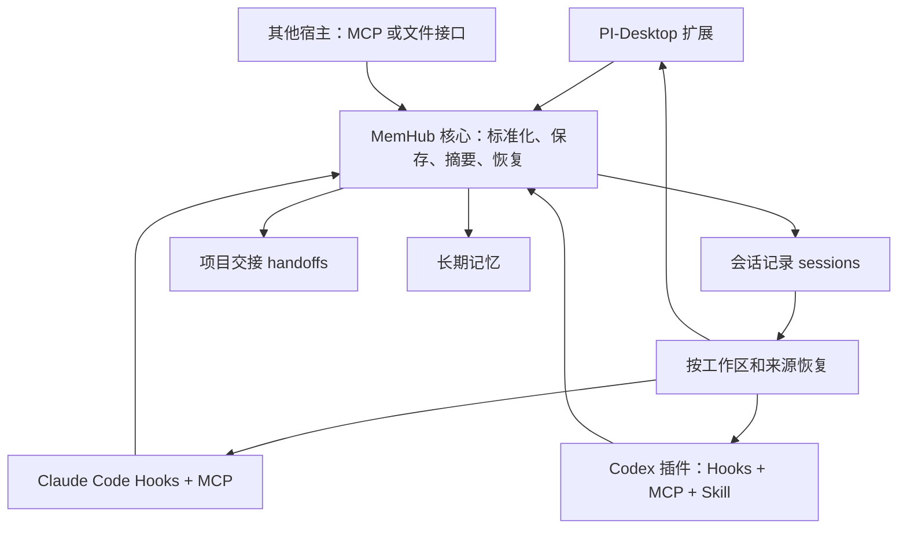

# 跨 Agent 共享与短期会话记忆方案

状态：设计进入分阶段实施。核心会话层、PI 扩展事件适配、独立摘要与诊断已有首版实现；真实宿主验收及 Claude/Codex 自动采集尚未完成。当前证据与下一步见 [会话层实施记录](session-memory-implementation.md)，下文仍保留完整目标，不代表所有能力已实现。

## 1. 要解决的问题

目前 MemHub 能共享长期记忆和主动保存的任务交接，但不能自动回答“我上一个会话和你说了什么”。新会话可能知道某个项目的状态，却不知道这条信息来自哪一段对话，也不知道上次哪里没有谈完。

已观察到的测试场景：

1. 用户在 memhub 工作区的 PI-Desktop 会话中更新了三个项目的阶段：PocketWorld 进入动作细调并持续优化，claude-remote 已公开仓库并宣传，memhub 正在测试。
2. 用户在同一工作区新开会话，新助手能看到一些项目概况。
3. 用户追问“那我上一个会话和你说了什么”，助手无法确认上一会话的内容和来源。

这暴露出两个不同需求：

- **项目延续**：知道项目现在做到哪里，接下来要做什么。
- **对话延续**：知道用户上一段说了什么，助手回答了什么，还有什么没谈完。

任务交接可以解决前者，但不能完整替代后者。方案增加独立的会话记录层，并让不同 Agent 使用同一套数据与协议。

## 2. 当前能力与缺口

| 能力 | 当前实现 | 本方案需要补充 |
| --- | --- | --- |
| 长期记忆 | 全局 `~/.memory` 和项目 `<repo>/.memory`；支持检索、读取、写入、替代和停用 | 保持用途，避免把聊天流水和阶段进度混入长期目录 |
| 项目交接 | `scope="handoff"`，同一 `task` 更新，支持状态和 TTL | 与会话记录关联；项目阶段使用固定的 `project-status` 键 |
| 启动恢复 | 加载 SOUL、协议、活跃交接和长期记忆目录 | 增加最近其他会话的摘要与最近一轮对话 |
| 后台复盘 | 筛选长期记忆候选，进入 Inbox 等待审批 | 会话摘要使用独立路径，不依赖长期候选是否产生或获批 |
| PI-Desktop | 插件工具、扩展事件和后台长期复盘 | 每轮保存会话、启动恢复会话 |
| Claude Code | Hooks、MCP 和后台长期复盘 | 对话转码、每轮保存和会话恢复 |
| Codex | 仓库当前安装逻辑主要配置 MCP；本机 CLI 0.162.1 已核实支持插件和 Hooks | 增加原生插件适配；桌面端单独验证 |
| Cursor、Pi CLI | 仓库提供 MCP 接入，自动化程度取决于宿主及规则 | 先支持统一接口主动保存和恢复，再核查各宿主事件能力 |
| DSH | 现有接入只声明共享文件库兼容 | 不能据此宣称支持自动续聊；需另查实际扩展接口 |

上一轮代码已补充 PI 工具的目标项目 `cwd` 参数，并修改进度分类规则，生成了 0.2.2 安装包；这些改动不等于已经实现本文的会话记录层，也不代表所有宿主已经安装或生效。

## 3. 记忆分类与归属

| 类别 | 内容 | 保存位置 | 更新方式 |
| --- | --- | --- | --- |
| 全局长期记忆 | 用户稳定偏好、通用经验、跨项目规则 | `~/.memory/{user,skills,decisions,…}/` | 经现有工具写入；同标题替代过时结论 |
| 项目长期记忆 | 技术栈、项目约定、架构决定 | `<repo>/.memory/{projects,skills,decisions}/` | 经现有项目记忆工具维护 |
| 项目状态和任务交接 | 当前阶段、待办、验收、阻塞、下一步 | `<repo>/.memory/handoffs/` | 阶段概况用 `task="project-status"`；具体任务各用固定键 |
| 最近会话记录 | 本段聊了什么、最后一轮原话、未完成的问题、来源 | `<repo>/.memory/sessions/` | 每个会话独立保存，逐轮更新 |
| 非项目目录的会话记录 | 不属于项目的日常对话 | `~/.memory/sessions/` | 绑定实际工作目录，默认按该目录恢复 |

**工作区归属和话题归属分开处理。**

在 memhub 会话中讨论 PocketWorld：

- 对话记录属于 memhub 工作区，供再次打开 memhub 或切换 Agent 时续聊。
- PocketWorld 的实际阶段更新写入 PocketWorld 的交接单。
- 不因为提到了另一个项目就创建全局长期记忆。
- 对话记录可保存对 PocketWorld 交接单的引用，但不会因此改变所属工作区。

`cwd` 决定目标工作区；`paths` 只参与内容检索匹配，不能代替目标目录参数。

## 4. 共享方式与适用边界

所有 Agent 使用同一套核心存储、标准化格式和读取逻辑，宿主适配器只负责取得事件、转换消息和注入上下文。



共享不按模型或供应商分库。`origin_agent` 只描述来源，不作为读取隔离条件：PI 可以读取 Claude 保存的记录，Codex 也可以继续同一工作区中的 PI 对话。

本期针对**同一台机器、可访问同一份记忆目录的本地 Agent**。远程容器、其他设备或云端 Agent 不能因为安装了同名插件就自动共享本机文件；这些场景需要额外的目录映射或服务连接，不属于本期实现范围。读取和写入仍遵循宿主的实际文件权限。

## 5. 数据结构

### 5.1 目录与标识

建议使用以下结构，文件名和字段在实现时形成带版本的公共协议：

```text
<repo>/.memory/
  sessions/
    .gitignore
    <session-key>/
      session.md
      turns.jsonl
  handoffs/
  projects/

~/.memory/
  sessions/                         # 非项目会话
  state/
    session-locations.json          # 跨工作区发现目录，只存定位信息
```

- `session.md` 是可直接阅读的 Markdown 摘要与最近对话快照，保持 MemHub 的文件可读性。
- `turns.jsonl` 是标准化且经过敏感信息处理的消息日志，供读取准确原话和重新生成摘要使用；它是辅助记录，不是长期记忆条目。
- `session-key` 由工作区标识、来源 Agent 和宿主会话 ID 共同计算，避免不同工具的会话 ID 撞名。文件路径不直接拼接未经校验的宿主 ID。
- 每个会话独立保存，不能让所有会话覆盖一个公共 `latest.md`。
- `session-locations.json` 只存工作区、会话键、时间和记录位置，不复制正文，不进入长期目录注入。可由各工作区记录重建；更新失败不影响本地会话记录的完整性。
- `sessions/` 默认不进入 Git，避免聊天内容随项目提交。创建 `.gitignore` 前保留已有规则，不覆盖用户配置。

### 5.2 会话元信息

`session.md` 的建议 Frontmatter：

```yaml
schema_version: 1
kind: session
session_key: "<SESSION_KEY>"
source_session_id: "<HOST_SESSION_ID>"
origin_agent: "pi-desktop"
workspace_id: "<WORKSPACE_KEY>"
workspace_root: "<ABSOLUTE_PROJECT_ROOT>"
started_at: "<ISO8601_WITH_MILLISECONDS>"
updated_at: "<ISO8601_WITH_MILLISECONDS>"
last_seq: 12
summary_through_seq: 10
summary_status: "pending"
parent_session_key: null
restored_from: ["<PREVIOUS_SESSION_KEY>"]
```

字段说明：

- 时间必须精确到毫秒，不能只使用长期记忆中的日期，否则同一天多段会话无法可靠排序。
- `last_seq` 表示已保存的消息序号；`summary_through_seq` 表示摘要覆盖到哪里，二者分开。
- `summary_status` 区分 `pending`、`ready`、`failed`；摘要失败不改变消息已保存的事实。
- `parent_session_key` 记录可识别的 fork 或父会话关系。子代理对话默认不作为用户的“上一个会话”候选。
- `restored_from` 固定本会话启动时选择的历史来源，避免“上一个会话”随着其他窗口发消息而悄悄变成另一段。
- 工作区初期以现有项目根判定逻辑取得根目录，并规范化路径；不同 Git worktree 默认分别恢复。目录搬迁和跨 worktree 合并发现留作后续能力。

正文分为：

1. 对话摘要：主题、用户明确提供的事实、已经确定的结论。
2. 尚未完成的问题：未回答的问题、待讨论的选择、需要用户确认的事项。
3. 最近一轮对话：按角色保存用户和助手的文本，标明序号与时间。
4. 关联记录：目标项目交接单或长期记忆的明确引用。

用户说的话、工具核实的事实、助手的建议必须区分。没有证据的助手推断不能在摘要中被改写为用户已确认的决定。

### 5.3 标准化消息

每条日志至少包含：`schema_version`、`session_key`、`message_key`、`seq`、`turn_id`、`role`、`created_at`、`text`。

- `message_key` 优先使用宿主稳定的消息 ID；宿主只提供 transcript 时，由适配器保存读取位置并生成稳定标识。
- 工具调用和结果单独标记类型，不冒充用户或助手原话。
- 摘要不保存隐藏推理过程；图片、附件只保存可用的描述与引用，不声称已保存或理解图片全部内容。
- 不把已注入的 `<memory-*>` 内容再次写回日志，避免记忆递归复制。

## 6. 每轮保存与后台摘要

### 6.1 先保存，再总结

每轮结束执行：

1. 从宿主事件或 transcript 提取本轮新增内容，去除注入块并过滤已知敏感内容。
2. 按稳定消息标识去重，将消息写入当前会话日志。
3. 原子更新 `session.md` 的元信息和最近一轮对话，使新会话可以立即读取。
4. 更新跨工作区定位目录；失败时留下可补偿状态，不回滚已经保存的消息。
5. 按配置触发后台摘要，将上一版摘要与尚未覆盖的消息交给摘要模型。
6. 摘要返回后按版本检查提交，只推进到这次实际覆盖的消息序号。

**不能只依赖会话关闭事件。** 用户可能保留旧会话并立即新开；宿主崩溃或强制退出也可能没有关闭回调。基础落盘应在每轮结束时完成，关闭事件仅作补存。

长回复生成或用户中断时，适配器能取得用户消息就尽早保存，并在宿主提供中断事件时补存已有输出。不能把被中断的操作记为已完成。

### 6.2 摘要与长期复盘分离

可以复用已有的模型请求与本地配置读取代码，但不能把会话摘要提交到 `proposeMemory(...requireReview: true)`：

- 摘要是对已发生对话的续聊记录，自动保存，不进入长期 Inbox。
- 长期复盘仍按现有写入规则筛选候选，并保留审批语义。
- 项目状态仍通过项目交接工具更新，摘要本身不擅自修改其他项目的状态。
- 摘要模型关闭、超时、不可用或返回无效内容时，最近对话照常可用，状态明确标为未完成或失败。
- 复用已配置的模型通道时明确说明用途；没有摘要模型配置也能保存和恢复消息，不要求为了基础续聊新增外部服务。

现有长期复盘有输入裁剪，不能把它的截断输入当作完整聊天记录。摘要只声明自己覆盖的消息范围；未保存或无法读取的历史不能凭摘要补写为原话。

### 6.3 并发与幂等

- 同一会话的重复事件只能保存一次；完整 transcript 多次回传不能产生重复消息。
- 追加消息和更新快照在同一会话事务内执行，恢复逻辑能够发现并修复“日志已写、快照未更新”的中断。
- 摘要请求发出后释放写锁，不在网络等待期间锁住全库。
- 旧摘要晚返回时，不得覆盖更新的摘要或最近对话快照。
- 两个并行主会话写各自的记录；公共定位目录的修改使用事务，避免丢失其他会话的位置。
- 沿用现有安全文件写入和事务机制，确需新增锁时保持统一获取顺序，避免与长期记忆、交接操作死锁。

## 7. 新会话如何恢复

### 7.1 默认选择

新会话启动时：

1. 确认工作区和当前宿主会话标识。
2. 加载原有 SOUL、协议、活跃项目交接和长期目录。
3. 查找同一工作区最近更新的其他主会话，不限制来源 Agent，排除当前会话本身和子代理记录。
4. 有明确父会话关系时优先使用父会话；其他情况按高精度时间排序。
5. 注入一份最近会话摘要、最新一轮对话，以及未被摘要覆盖的新消息所形成的续聊上下文。
6. 记录本次实际恢复的来源，后续回答“上一个会话”时优先使用该来源。

新块建议命名为 `<memory-session>`，包含来源 Agent、工作区、时间、摘要覆盖范围。所有历史内容都作为参考数据，不能成为系统指令；复用现有标签转义和敏感信息过滤。

初期默认注入最近一个候选，其他会话按需查询。这里限制的是单次启动展示范围，不限制实际保存多少会话；复用现有上下文裁剪方式，裁剪时明确标记并提供进一步读取入口。

如果两个窗口同时活跃且“上一会话”有多个合理解释，应说明候选的来源和时间，不能把两段对话拼接成一段用户原话。

### 7.2 跨工作区查询

默认恢复同一工作区，避免打开项目 A 时无条件注入项目 B 的聊天。

- “上一个会话说了什么”：默认指本工作区启动时恢复的来源。
- “我刚在 Claude 里聊了什么”：按来源 Agent 查找最近会话，返回时说明工作区。
- “我最近所有工具里的上一段聊天”：显式跨工作区、跨 Agent 查找。
- 目标不明确且候选冲突时，展示简短候选供用户选择，不自行判断不同项目是同一任务。

跨工作区发现先查定位目录，再按宿主允许的路径读取原记录。不能只把原宿主的 transcript 路径交给另一个 Agent：统一记录必须已导出到 MemHub，原路径只作为来源线索。

### 7.3 回答依据与事实新旧

- 复述时明确“你在上一会话中说过”，需要逐字引用则读取日志，不能把模型摘要加引号冒充原话。
- 用户最新指示优先于历史摘要。
- 查询项目当前状态时，优先读取目标项目的有效状态交接；长期记忆中的历史 PR 描述不能当作当前进度。
- 会话摘要说明“当时聊了什么”，并不保证文件、测试和部署现在仍是那个状态。恢复开发任务时继续执行现有的 Git 状态或测试核验。
- 查不到就明确说明未保存或未接入，不声称自己完整记得。

## 8. 各 Agent 的接入方式

| 宿主 | 自动恢复 | 自动保存 | 特别要求 |
| --- | --- | --- | --- |
| PI-Desktop | `before_provider_request` 构造启动块时调用统一恢复逻辑 | `agent_end` 保存，`session_shutdown` 补存；用户消息尽早保存 | 处理事件可能包含历史消息的情况，不能依赖新会话触发旧会话关闭 |
| Claude Code | `SessionStart`，压缩后重新构建必要上下文 | `UserPromptSubmit` 保存用户输入，`Stop` 保存本轮，`SessionEnd` 补存 | transcript 先转换为统一格式；长期复盘不代替会话落盘 |
| Codex 原生插件 | `SessionStart` 注入恢复上下文 | `UserPromptSubmit`、`Stop`，必要时 `Interrupt` 和 `SessionEnd` 补存 | CLI 和桌面端分别测试 Hook 实际可用性、信任状态与输入格式 |
| Cursor、Pi CLI 等 | 通过 MCP 的启动恢复接口，自动化待宿主验证 | 通过 MCP 提交本轮内容，自动事件适配待验证 | 仅安装 MCP 不等于每轮必定自动保存 |
| DSH | 待核查宿主接口 | 待核查宿主接口 | 文件可读兼容不等于自动对话采集兼容 |

### 8.1 Codex 插件设计

Codex 插件与 PI 的 JS 扩展不是同一套格式。拟建立独立适配目录 `adapters/codex/`，组合：

- `.codex-plugin/plugin.json`：插件清单。
- `hooks/hooks.json`：生命周期 Hook 声明。
- MCP 配置：暴露统一的读取和写入工具。
- Skill：说明分类、恢复、来源引用和跨项目目录选择。
- 轻量执行入口：调用 MemHub 核心或 CLI，不复制另一套存储实现。

官方文档确认插件可携带 Hooks；本机 CLI 已核实 `plugins` 和 `hooks` 功能启用。但这只是接口和版本证据，不能替代 MemHub 的端到端测试。

实现时注意：

- `SessionStart` 使用本地命令调用核心，避免依赖尚未连接就绪的 MCP 服务。
- 每轮 `Stop` 先完成基础落盘，再触发可选摘要；不要把关键保存只放在可被会话结束取消的异步 Hook 中。
- `SessionEnd` 有较短超时，不承担网络摘要等待，也不作为唯一保存点。
- 官方说明切换离开会话不会立即触发 `SessionEnd`。
- `transcript_path` 可能为空，且 transcript 格式不是稳定接口；适配器必须检测格式和可读性，并标注采集缺口。
- 插件 Hooks 需经宿主信任审查，更新脚本也可能要求重新审查。未经信任而未运行时应能诊断，不能报告“已启用自动记忆”。
- 自动化验证 Codex CLI 时使用独立的 `CODEX_HOME`，不触碰桌面客户端的认证目录。

参考：[插件说明](https://learn.chatgpt.com/docs/plugins)、[Hooks 文档](https://learn.chatgpt.com/docs/hooks)。

## 9. 拟新增的核心接口

以下为统一接口设计；核心会话接口与 MCP / PI 工具映射已落地，详见实施记录。自动化支持仍按宿主分别验收：

| 接口 | 用途 | 关键输入与输出 |
| --- | --- | --- |
| `captureSession` | 幂等保存标准化消息，更新最近快照 | 输入来源、会话、工作区、消息；返回已保存序号和记录位置 |
| `summarizeSession` | 更新某会话的摘要 | 输入会话及目标序号；返回实际覆盖范围和状态 |
| `restoreSessionContext` | 选择历史会话并生成注入块 | 输入工作区、当前会话、可选父会话；返回来源和上下文 |
| `listSessions` | 按工作区、来源和时间查找会话 | 默认本工作区；跨工作区由显式参数开启 |
| `loadSession` | 读取摘要或指定范围的原话 | 输入会话定位及消息范围；返回来源、范围、缺口和内容 |

`memory_boot` 与 PI 启动块构造复用 `restoreSessionContext`，不各自实现选择策略。MCP 和 PI 工具暴露必要的会话查询、读取与采集入口，明确与现有 `scope=global|project|handoff` 的区别，不把 `session` 硬塞进长期提案流程。

现有长期目录、搜索和 doctor 检查不得将 `sessions/` 当成长久有效的知识条目；会话查询有独立的数据类型和返回结构。

## 10. 保留、配置与可诊断性

### 10.1 保留策略

本期不增加容量上限，不自动物理删除历史会话，也不把现有 handoff 默认 14 天 TTL 直接套到会话记录。

“短期”表示这类内容用于近期续聊，且默认只展示最近记录，不表示到期就丢掉原文。后续如需容量和清理策略，应单独设计；归档与物理删除沿用明确的用户授权边界。

### 10.2 配置与诊断

为会话采集和模型摘要提供独立开关；关闭摘要模型不等于关闭基础消息保存。沿用本地配置文件优先解决 GUI 环境不继承终端变量的问题。

诊断至少能说明：

- 当前 Agent 是否接入采集和自动恢复，Hook 是否被信任。
- 当前工作区、最近成功保存时间与消息序号。
- 摘要覆盖到哪里，是否有未覆盖的新消息，最近失败原因。
- 启动时选择了哪个来源，会话摘要是否裁剪。
- 跨工作区定位目录是否可用或需要重建。

诊断日志只记录定位、状态和错误类别，不输出聊天正文、凭据或完整模型请求。摘要请求成功不等于摘要解析、落盘和恢复都成功，各阶段应分别记录。

## 11. 实施顺序

1. **核心会话存储与读取**：标准化格式、独立会话文件、去重、原子快照、定位和原话读取。没有摘要模型也能恢复最近消息。
2. **PI 自动续聊**：每轮保存，启动恢复，旧窗口不关闭也能读取上一轮。先把当前已暴露的问题跑通。
3. **后台摘要与诊断**：增量覆盖、乱序保护、失败降级、状态查询，与长期复盘分开。
4. **Claude Code 接入**：共用核心，验证 PI → Claude 和 Claude → PI 双向续聊。
5. **Codex 原生插件**：打包 Hooks、MCP 和 Skill；分别验证 CLI 和桌面端，并与 PI、Claude 互通。
6. **其他宿主与迁移**：按实际能力补自动化；既有会话可通过明确的导入操作生成记录，不能声称方案上线前的所有聊天已经被采集。

本设计文档本身不承担安装或历史导入；首阶段实施与测试记录见 [会话层实施记录](session-memory-implementation.md)。

## 12. 验收标准

以下为整套方案的验收目标；已执行的核心与 PI 扩展事件测试见实施记录，尚未据此宣称真实宿主或整套跨 Agent 验收通过。

| 场景 | 操作 | 必须观察到的结果 |
| --- | --- | --- |
| 同工具新会话 | PI 会话 A 提供项目进度，等待本轮结束，不关闭 A 就新开 B | B 能说明 A 中用户说了什么，并标明来源；不依赖 A 的关闭回调 |
| 用户话语与助手建议 | 用户提出问题，助手给出尚未确认的建议，再新开会话 | 新助手能区分用户要求和助手建议，不把建议当成已定决定 |
| 跨 Agent 双向续聊 | PI 写入，Claude 恢复并追加，再由 PI 新会话恢复 | 双向读取同一工作区记录；无手工复制或重新描述要求 |
| Codex 互通 | 分别在 Codex CLI、桌面端与 PI 之间切换 | 每个已支持的宿主均能自动保存与恢复；明确列出未支持或未验证的版本 |
| 跨项目讨论 | 在项目 A 聊 B 的进度，再打开 A 和 B | A 有该段对话，B 有自己的进度交接；没有新增全局长期流水 |
| 摘要尚未完成 | 保存一轮后立即新开会话，模型摘要仍在运行 | 新会话能读取已保存的最近原话，明确摘要覆盖范围 |
| 模型故障 | 禁用摘要模型或模拟超时、无效响应 | 对话仍成功保存和恢复；长期 Inbox 不承担续聊兜底 |
| 重复事件 | 同一轮事件重复触发或重复提供完整 transcript | 消息不重复，序号不倒退，摘要内容不递归膨胀 |
| 并行与乱序 | 两个会话同时写入，较旧摘要晚于新摘要返回 | 会话互不覆盖；旧摘要不能覆盖新记录；“上次”来源可解释 |
| 中断与重启 | 已保存消息后中断摘要，再重启宿主 | 恢复已保存对话，补齐可恢复快照；不把未完成工具动作记成成功 |
| 长对话 | 历史超过自动注入展示范围，用户询问更早一句话 | 自动块明确裁剪，能够按需读取已保存原话；未保存内容明确说明缺失 |
| 工作区隔离与发现 | 默认打开 A，再显式询问其他工作区的最近会话 | 默认不注入 B；显式查询能定位 B，并标明工作区和 Agent |
| 采集与权限 | Codex Hook 未信任，或目标目录不可读写 | 诊断明确指出未采集或无法恢复，不谎报成功，也不转存到无关全局长期库 |
| 敏感内容与注入回流 | 输入测试凭据、带记忆标签的历史块 | 已知敏感内容被过滤；注入块不重复写回；摘要与诊断不输出凭据 |

首阶段必须先在 PI 中验证即时恢复、来源区分、项目归属和摘要等待降级。整套方案完成时，PI、Claude、Codex CLI 及经确认支持的 Codex 桌面端还必须通过双向续聊验证；桌面端若被证实缺少必要接口，应明确列出限制，不能将其标为已支持。其余涉及并发、故障和数据完整性的检查也必须在对应能力交付前通过。每项记录宿主版本、保存序号、恢复来源和观察结果，不只以模型接口 HTTP 成功作为证据。
